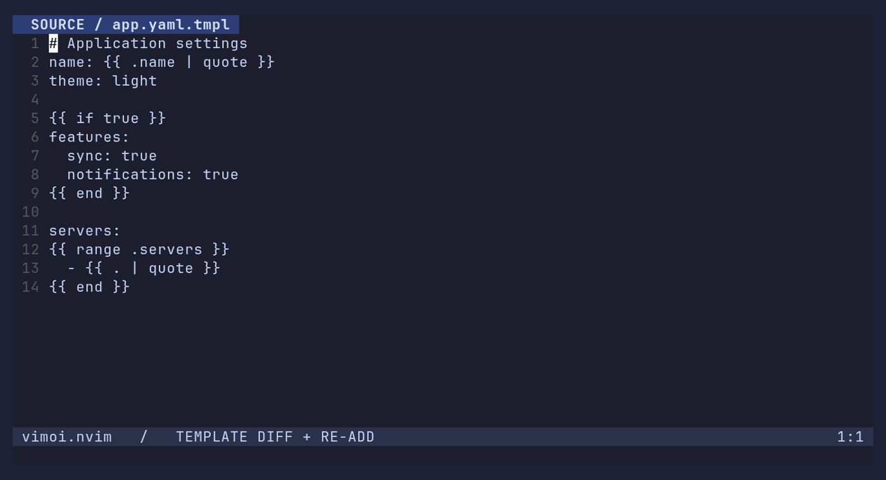

# vimoi.nvim

Edit [chezmoi](https://www.chezmoi.io/)-managed files safely and comfortably in Neovim.

[简体中文](README.zh-CN.md) · [English help](doc/vimoi.txt) · [中文帮助](doc/vimoi.cnx)

> This project is in alpha. APIs and behavior may change.

## Demos

Edit an unsaved template while its read-only preview updates alongside it, including
conditional branches and undo:


Compare a template with its target and manually re-add static changes to the source,
preserving template expressions. Changes to dynamic output remain for manual editing:



[Preview MP4](docs/demos/preview.mp4) · [Re-add MP4](docs/demos/readd.mp4) · [Recording guide](docs/demos/README.md)

## Features

- Switch between chezmoi source and actual target files, preserving unsaved changes on both sides.
- Preview templates while editing, or compare templates with targets and transfer individual hunks in either direction.
- Manual ReAdd: copy target content back to plain source files, or write back identifiable static changes while preserving template expressions.
- Template diagnostics, host language highlighting, blink.cmp completion, and path navigation.

All write-back operations are explicitly triggered by the user and only modify buffers.
They do not save automatically or run chezmoi apply.

## Requirements

- Neovim 0.12+.
- chezmoi 2.x, available on `PATH` or specified in the configuration.
- The `gotmpl` Tree-sitter parser for template features. Target language parsers are optional;
  highlighting falls back to Vim syntax when unavailable.

Tested on Linux with Neovim 0.12.6 and chezmoi 2.73.3. Other platforms have not been verified.

## Installation

With lazy.nvim:

```lua
{
  "dirichy/vimoi.nvim",
  lazy = false,
  opts = {},
}
```

With another plugin manager, install `dirichy/vimoi.nvim` and call:

```lua
require("vimoi").setup()
```

After installing the gotmpl parser and configuring the plugin, run `:checkhealth vimoi`.
Set `vim.g.mapleader` before setup to use the default mappings below.

You can also lazy-load with `ft = "gotmpl"`, but opening a plain source file will not
trigger loading. Use the startup configuration above for plain source filetype detection
and global commands.

## Quick start

Open a chezmoi-managed source or target file:

| Command | Purpose |
| --- | --- |
| `:VimoiToggle [path]` | Open the other side of a source/target pair |
| `:VimoiPreview [source]` | Preview a template's read-only rendered output |
| `:VimoiDiff` | Compare the current file's source and target |
| `:VimoiDiff {source} {target}` | Compare an explicit file pair |
| `:VimoiReAdd [path]` | Write target changes back to the source buffer |
| `:VimoiCancel` | Cancel a running command |

### Edit and preview a template

1. Run `:VimoiToggle` to switch to the source template.
2. Run `:VimoiPreview` and keep editing in the source window.
3. The read-only preview updates on the right without saving the source first.

You can also run `:VimoiPreview /path/to/source.tmpl`. Unnamed buffers and template
fragments without a standalone target are supported. Preview does not modify the actual
target. If rendering fails, the previous output is retained and marked as stale.

Repeated diff/preview commands reuse the current window pair. Closing either window or
replacing its buffer ends the view. Set `split = "horizontal"` for a horizontal split;
existing windows are not rearranged.

### Compare and transfer a hunk

Run `:VimoiDiff`, use `[c` / `]c` to navigate changes, and use native fold keys to show
or hide context. In a template diff, the transfer directions are:

| Current window | `do`: get into the current window | `dp`: put into the other side |
| --- | --- | --- |
| Source template | Write the current target hunk back to the template | Write the current hunk's rendered output to the target |
| Target | Get the template's rendered output for the current hunk | Write the current hunk back to the template |

Alternatively, run `:VimoiDiffPut` to write the current target hunk into the template,
or `:VimoiDiffApply` to write the current hunk's rendered output into the target.
Changes on both sides support undo/redo and are not saved automatically.
Changes to dynamic output cannot be inverted into template expressions; edit the source
manually. Ambiguous static insertion positions prompt you to choose a location.

These template operations require the plugin mappings or commands. Native `:diffget` /
`:diffput` or `normal!` copy template source text. Plain files use native two-file diff,
where `do` / `dp` keep their native meaning.

### Write target changes back to the source

Run `:VimoiReAdd`, or specify a source or target path:

```vim
:VimoiReAdd /path/to/file
```

- **Plain text files:** read both current buffers without saving and copy all target
  content into the source. Existing unsaved source content is replaced; one undo restores
  it. Identical content does not trigger another change.
- **Templates:** write back identifiable static changes in bulk while preserving expressions.
  Dynamic or uncertain changes remain for manual editing. Choose a location when an insertion
  is ambiguous; canceling the choice skips that insertion.

A diff opens when needed. You can wait for template rendering or cancel it. An existing
diff is reused; a read-only preview switches to a diff with the actual target.
For plain files, the target must exist or already be open in a buffer.
Encrypted files, symlinks, and script sources are not supported by plain text ReAdd.

Review the result and run `:write` in the source window. ReAdd does not invoke the chezmoi
CLI's re-add, update file attributes, save automatically, or apply changes.
Likewise, `VimoiDiffApply` only modifies the current target hunk; it is not chezmoi apply.

### Compare two buffers without file paths

Pass two loaded buffers in source/target order. Unnamed and scratch buffers are supported:

```lua
require("vimoi.api").diff_buffers(source_buf, target_buf, { filetype = "yaml" })
```

The source is rendered as a chezmoi template using the configured template data and
gets the `gotmpl` filetype. Optional `filetype` sets the host language for source
highlighting and the target's filetype; omit it to use the target's current filetype,
falling back to detection from its name and contents. `0` means the current buffer;
source and target must be different loaded buffers.

The view supports the same hunk operations and `:VimoiReAdd` as a template file diff.
It uses current buffer contents, leaves buffer names intact, and never validates
against `chezmoi cat`, even when `diff.validate = true`. Closing or replacing either
window ends the view. No files are saved automatically.

## Use as a chezmoi diff / merge interface

Open a managed source or target in Neovim and run `:VimoiDiff` to compare and merge
changes manually, without changing your chezmoi configuration. Templates compare rendered
output with the actual file while keeping the source editable. See the tutorials above
for individual hunks and bulk write-back. Changes to dynamic output still require manual
template editing.

### Open from `chezmoi merge`

Make sure the plugin is loaded and setup has completed at Neovim startup, for example
with the `lazy = false` configuration above. Add this to `~/.config/chezmoi/chezmoi.toml`:

```toml
[merge]
command = "nvim"
args = [
    "-c",
    "lua require('vimoi.api').diff_files(vim.fn.argv(0), vim.fn.argv(1))",
    "--",
    "{{ .Source }}",
    "{{ .Destination }}",
]
```

Then run:

```sh
chezmoi merge ~/.bashrc
```

chezmoi passes the source and actual file paths to the plugin. The plugin renders the
template itself, so `.Target` is not passed. This opens the plugin's two-window template
comparison rather than a native three-file merge layout.
Template source buffers use the `gotmpl` filetype, with the target language injected
for highlighting; the actual file keeps its own filetype.
Use `do` / `dp` for individual hunks or `:VimoiReAdd` to write back identifiable static
changes in bulk. Review the result, run `:write` in each window whose changes you want
to keep, then exit with `:qa`. The plugin does not save or apply automatically and does
not replace chezmoi's file attribute or encryption operations.
See the [chezmoi merge reference](https://www.chezmoi.io/reference/commands/merge/) for the argument definitions.

If you use another configuration file via `chezmoi --config /path/to/chezmoi.toml`, also
set `chezmoi_config_path` to that path in Neovim so both use the same source and template data.

If you put this configuration in a `.tmpl` that generates your config file, replace
the two path arguments with:

```gotmpl
    {{ printf "%q" "{{ .Source }}" }},
    {{ printf "%q" "{{ .Destination }}" }},
```

This preserves the placeholders in the generated TOML for expansion when merge runs.

### `chezmoi diff` limitation

For now, keep your existing `chezmoi diff` configuration and use `:VimoiDiff` inside Neovim.
chezmoi's external diff interface provides `.Destination` and the rendered `.Target`,
without directly providing `.Source`. The merge configuration above cannot be reused
as-is to compare and write back template source through that interface.
See the [chezmoi diff guide](https://www.chezmoi.io/user-guide/tools/diff/) for details.

## Configuration and default mappings

The complete defaults are shown below. Only specify the options you want to change:

```lua
require("vimoi").setup({
  chezmoi_executable = "chezmoi", -- Can also be an executable wrapper
  chezmoi_config_path = nil, -- Optional chezmoi configuration file path
  split = "vertical", -- Or "horizontal"
  watch = { buffer_write_fallback = "auto" },
  diff = { validate = false },
  completion = { enabled = true },
  diagnostics = { enabled = true, host = true },
  highlight = {
    mode = "injection",
    template_bg = { dark = "#343B52", light = "#E4E9F4" },
  },
  keymaps = {
    diff = "<leader>cd",
    preview = "<leader>cp",
    toggle = "<leader>ct",
    invalidate_cache = "<leader>cr",
    readd = "<leader>ca",
    cancel_command = "<leader>cx",
    goto_file = "gf",
    goto_file_line = "gF",
    diff_get = "do",
    diff_put = "dp",
    fold_open = "zo",
    fold_close = "zc",
    fold_toggle = "za",
    fold_open_recursive = "zO",
    fold_close_recursive = "zC",
    fold_toggle_recursive = "zA",
    fold_open_all = "zR",
    fold_close_all = "zM",
  },
})
```

Global defaults are `<leader>cd` for diff, `<leader>cp` for preview, `<leader>ct` to toggle,
`<leader>ca` for ReAdd, `<leader>cr` to refresh caches, and `<leader>cx` to cancel commands.
`gf` / `gF` are enabled only in templates and symlink sources. Template diff hunk and fold
mappings are active only while the corresponding window is focused.

Set a mapping to a string to change it, or to `false` or an empty string to disable it.
Set `keymaps = false` to disable all mappings:

```lua
require("vimoi").setup({ keymaps = { diff = "<leader>hd", readd = false } })
```

`chezmoi_config_path` supports `~` and relative paths, resolved against the working directory
at setup time. `$` is kept literally. Pass environment variables explicitly, for example
`chezmoi_config_path = vim.env.MY_CHEZMOI_CONFIG` after setting that variable.

Executable/config paths, watch options, and keymaps are fixed after the first successful
setup; restart Neovim to change them. Other options can be updated by calling setup again;
omitted updatable options revert to defaults.
`highlight.template_bg` also accepts a single color string.

## Template diagnostics and highlighting

Template diagnostics are enabled by default, without opening diff or preview. Edits trigger
syntax and execution checks using native Neovim diagnostics alongside other LSP diagnostics.
Disable them with `diagnostics = { enabled = false }` and customize their appearance with
`vim.diagnostic.config()`.

Host diagnostics automatically use the target's filetype and your existing checker
configuration. Enable the corresponding server with `vim.lsp.enable()` as usual,
or configure `require("lint").linters_by_ft` for nvim-lint. The plugin checks rendered
output and maps diagnostics back to the template, preserving each provider's source,
severity, and code. No extra checker list is needed in vimoi.
Messages use `[gotmpl]` for template errors and `[host:lua]`, `[host:yaml]`, etc.
for projected host diagnostics, so they remain distinguishable in any diagnostic UI.

Static text gets precise source ranges; errors in dynamic output point to the producing
template region and are marked as template-generated. Repeated source locations are
deduplicated; output with ambiguous source locations is skipped. Only the currently
rendered branches are checked. Set `diagnostics = { host = false }` to disable host
checks while keeping template diagnostics.

Host checks require a known host filetype and an enabled LSP or configured nvim-lint
provider. nvim-lint integration runs stdin-capable linters only. Other checker plugins
are not integrated. Checks use hidden, unsaved snapshots with unique names beside the
target (or source/current directory when no managed target is available). Project root
discovery works normally, but rules tied to an exact filename, such as some YAML schema
associations, may need adjustment. Real target buffers and files are untouched.

Diagnostics and previews execute template functions and may invoke password helpers.
Slow tasks can be canceled and have no default timeout.
The host language is detected from the target name and shebang; for example,
`dot_zshrc.tmpl` uses zsh highlighting. Highlighting may be inaccurate when templates
assemble incomplete host language statements.

To try highlighting from the complete rendered output instead of host injections:

```lua
require("vimoi").setup({ highlight = { mode = "rendered" } })
```

This experimental mode uses the host's Tree-sitter queries, colors, and priorities,
and maps visible literal text back to the template. Template actions keep gotmpl
highlighting. It shares the asynchronous render cache and works with diagnostics
disabled. Existing colors follow edits while rendering is pending, and a successful
render replaces them. Temporary template errors keep the last successful colors.
Literal text not executed in the current render uses your colorscheme's `Comment`
highlight, while template actions keep gotmpl highlighting. Repeated loop text uses
its first execution.
LSP semantic tokens, whole-line conceal, and spell navigation are not projected.
The default remains injection highlighting; set `highlight.mode = "injection"` to return
to it. A missing host parser still uses the Vim syntax fallback.
Use `highlight.mode = "disabled"` to turn off host highlighting, including the Vim
syntax fallback. Template actions retain their gotmpl highlighting and background;
diagnostics and source mapping are unaffected.

## blink.cmp completion

Completion integrates with blink.cmp only. Register the source in its configuration:

```lua
require("blink.cmp").setup({
  completion = {
    accept = {
      auto_brackets = {
        blocked_filetypes = { "gotmpl" },
      },
    },
  },
  sources = {
    default = { "lsp", "path", "snippets", "buffer", "vimoi" },
    providers = {
      vimoi = {
        name = "Vimoi",
        module = "vimoi.blink",
        score_offset = 100,
      },
    },
  },
})
```

Completes template functions, data fields, current buffer variables, and include/template/glob
paths without displaying data values. Outside template actions, it offers `if`, `ifelse`,
`range`, `with`, `define`, `block`, and `comment` snippets.
`blocked_filetypes` prevents inappropriate parentheses from being added when accepting
template function completions.

## Path navigation

Use `gf` in templates or symlink sources. `gF` also supports `path:line` / `path:line:column`.

| Context | Path base |
| --- | --- |
| `include "path"` | chezmoi source directory |
| `template "name"` / `includeTemplate "name"` | `.chezmoitemplates` |
| `glob "pattern"`, `.chezmoiignore` / `.chezmoiremove` | Destination directory |
| `symlink_*` content | Directory containing the generated symlink |
| Absolute paths, `~` paths, and `file://` URLs | File system |

Multiple matches open a picker; unresolved paths fall back to native navigation.
Managed destination paths open their source preferentially. With optional vim-matchup
and its Tree-sitter matching enabled, `%` jumps between template control blocks.

## Cancel tasks and refresh manually

Background tasks show progress in the upper right. Run `:VimoiCancel` or `<leader>cx`;
a single task is canceled directly, while multiple tasks open a picker.
In a focused waiting float, press `q`, `Esc`, or `Ctrl-C` to cancel. Closing or leaving
the float also cancels. Canceling the initial render ends the view and preserves both
buffers; canceling a wait prevents the pending write-back from continuing.

Changes to data, configuration, and discovered shared templates trigger automatic refresh.
If results are stale, press `<leader>cr` or run:

```lua
require("vimoi.api").invalidate_cache()
```

New directories, environment variable changes, or failed file watchers may require manual
refresh. For file systems that silently lose watcher events, set
`watch.buffer_write_fallback = true` to refresh when saving in the current Neovim instance.
`false` disables this fallback; the default `"auto"` enables it as needed.
Restart Neovim after changing the source root directory.

## Known limitations

- Changes to dynamic or repeated template output usually require manual source edits;
  general reverse merging is not supported.
- Custom template delimiters and empty define/block overrides that depend solely on
  whitespace/comments are not supported.
- Templates whose output depends on `.chezmoi.sourceFile`, `.chezmoi.targetFile`,
  `.chezmoi.command`, or `.chezmoi.args` are not supported, including includeTemplate
  calls that read those fields indirectly.
- `diff.validate = true` additionally checks template rendering against chezmoi cat and
  refuses to open the diff on mismatch. It is off by default and does not apply to previews
  of unsaved content or make the unsupported templates above supported.
- Source text must not contain the reserved sentinel prefix used by the current run,
  and dynamic output must not produce complete reserved markers. Random markers only
  reduce accidental collision risk; see `:help vimoi-limitations` for details.
- No automatic re-add or apply. The plugin does not replace chezmoi CLI file attribute
  or encryption operations.

## Lua API and help

```lua
local api = require("vimoi.api")
api.toggle()                -- Switch between source and target
api.preview()               -- Preview the current template
api.diff()                  -- Open a diff for the current file
api.diff_buffers(source_buf, target_buf, { filetype = "yaml" })
api.readd()                 -- Write target changes back to the source buffer
api.cancel_command()        -- Cancel a running command
```

These are interactive entry points. Diff/preview operations, including `diff_buffers`,
return `nil`. Write-back operations also
return `nil` while rendering or waiting for a choice, so this does not indicate final success.
See `:help vimoi-api` for arguments, immediate results, and other operations.

```vim
:help vimoi.nvim
:set helplang=cn
:help vimoi.nvim@en
:help vimoi.nvim@cn
```

## Development and roadmap

- [FEATURES](FEATURES.md): implemented features and future candidates.
- [Preview performance comparison](docs/preview-benchmark.md) and [buffer write measurements](docs/buffer-edits.md).
- [Re-record the README demos](docs/demos/README.md).

Run tests with `python3 tests/run.py`, optionally followed by test filenames.
Tests require Python 3, a Unix shell, and the dependencies above, and use isolated
configuration and temporary files.
Check formatting with `stylua --check lua ftdetect tests docs/demos/init.lua`.
LuaLS should use the real Neovim runtime library and retain all diagnostic levels.

## License

[MIT](LICENSE), Copyright (c) 2026 dirichy.
